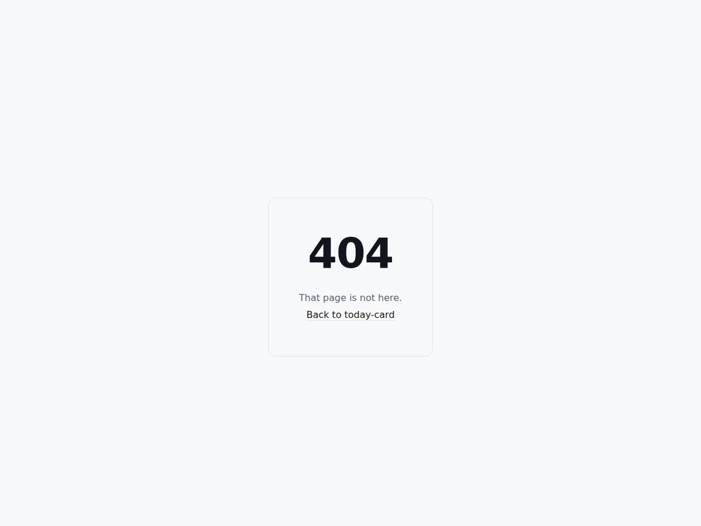

# Today Card

<!-- shot:start -->



<!-- shot:end -->

[](https://drsamonline.github.io/today-card/)
[](LICENSE)
[ and attaches them to the `app-latest`
release. See `.github/workflows/build-apps.yml`.

## Structure

```
docs/index.html      the app
docs/web-kit.js      the shared runtime (from drsamonline/web-kit)
```

<!-- support:sweep -->
## Support

One person's work: no company, no ads, no tracking, no paid tier. If it saved you an
afternoon, a contribution keeps the next one coming — any amount, or none.

| | |
|---|---|
| **UPI** | `drsohilboi@ybl` |
| **Ko-fi** | [ko-fi.com/matneo](https://ko-fi.com/matneo) |
| **PayPal** | [paypal.me/drsohilmomin](https://paypal.me/drsohilmomin?locale.x=en_GB&country.x=IN) |
| **Books** | [the author's other work](https://www.amazon.com/stores/author/B08ZT331LY/allbooks) |
| **Elsewhere** | [all projects](https://drsamonline.github.io/) |
| **Email** | [sohilmomin2000@gmail.com](mailto:sohilmomin2000@gmail.com) — bugs, corrections, requests |

## Licence

MIT. (c) 2026 Dr Sohil Momin.
